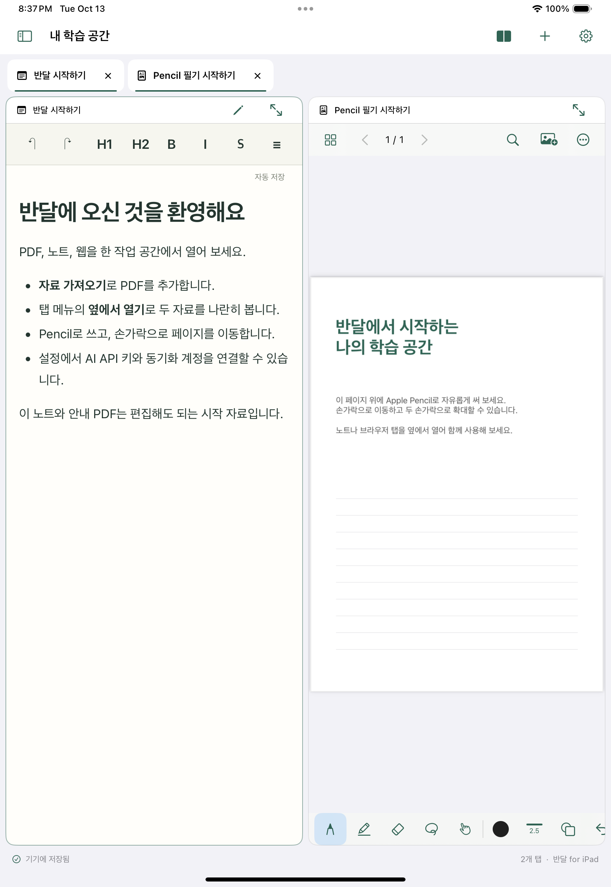

# iPad 구현 현황과 남은 검증

기준일: 2026-10-13. 이 저장소는 **실행 가능한 개발 검증 버전**이다. 데스크톱 반달의 모든 기능을 동일하게 제공하는 첫 정식 버전이 완성된 상태는 아니다. 아래에서 “구현”은 실제 저장·조회·실행 경로가 연결되었다는 뜻이며, 실기기 품질 검증이나 데스크톱의 전체 동작 재현을 뜻하지 않는다.

사용자가 정한 목표는 iPad 전용 앱, 여러 탭과 기본 2개 작업 영역, 손과 Apple Pencil을 고려한 조작, 양방향 자동 동기화, 개인 API 키로 독립 실행하는 AI, 첫 정식 버전의 전체 학습 기능이다. 현재 코드는 SwiftUI/UIKit·PDFKit·PencilKit·WKWebView를 중심으로 구성하고, 기존 React/Milkdown 편집기와 문서 파서를 앱에 포함해 재사용한다. 최소 OS는 iPadOS 18이며 iPhone·Mac Catalyst는 대상이 아니다.

## 앱에서 구현한 기능과 차이

| 영역 | 현재 연결된 기능 | 남은 차이·검증 |
|---|---|---|
| 작업 공간 | 과목·자료·폴더, 여러 종류의 탭, 탭 순서 변경, 옆에서 열기, 2분할, 좁은 창에서 영역 전환, 재실행 시 일반 작업 공간 복원 | 실제 iPad 창 크기·회전·키보드·메모리 압박을 조합한 장시간 사용 검증. 모든 데스크톱 배치 방식의 이식은 아님 |
| 브라우저 | WKWebView 세션 재사용, 주소·검색·뒤로·앞으로·새로고침, 일반/비공개 탭, 팝업용 세션, 파일 업로드·다운로드·자료 가져오기, 프로세스 종료 안내 | 실제 사이트의 로그인·POST 팝업·미디어·다운로드 호환성 검증. WebKit과 데스크톱 Chromium의 차이가 있으며 확장 프로그램·데스크톱 브라우저 AI 조작은 구현하지 않음. 메모리 압박으로 해제된 탭은 URL을 복원하며 입력 중인 웹 폼 상태까지 보장하지 않음 |
| PDF·필기 | PDFKit 열기·검색·페이지 이동·읽던 위치, 텍스트 선택·강조, PencilKit 펜·형광펜·지우개·획 선택, 실행 취소/다시 실행, 도형·이미지 삽입, 페이지 노트, 필기 포함 내보내기 | Apple Pencil 지연·압력감·손바닥 접촉·줌 중 입력을 실기기에서 확인해야 함. 도형·이미지의 공통 선택·이동·크기 조절·다중 선택 UX는 미완료 |
| 화이트보드 | 확대·이동 가능한 고정 크기 캔버스, PencilKit 필기와 휴대 가능한 필기 레코드 저장 | 무한 캔버스가 아님. 데스크톱 객체 편집·배치 기능 전체와 동일하지 않음 |
| 노트 | 앱에 포함된 React/Milkdown WYSIWYG, 서식 도구, Markdown 저장, 편집 복구 저널, 자료·PDF 페이지 링크, 링크를 별도 브라우저로 열기 | 파일·이미지·복잡한 표 등 데스크톱 편집기의 모든 확장 기능 비교가 남음. 저장 한도를 넘으면 성공으로 표시하지 않고 내용과 복구 사본을 보존 |
| Office·HWP | DOCX 읽기, XLSX/XLS/CSV 표 읽기, HWP/HWPX 텍스트 미리보기, PPTX 렌더링·PDF 변환·슬라이드 필기 | Office 원본 편집기가 아님. 복잡한 수식·글꼴·차트·도형 배치의 원본 재현율 검증이 필요하며 HWP는 원본 레이아웃을 재현하지 않음 |
| 구형 PPT | 인증된 변환 요청용 iPad 클라이언트와 격리된 LibreOffice 서버 코드, 변환 PDF를 별도 자료로 보관 | **변환 서버 미배포**. 실제 LibreOffice 변환·한글 글꼴·격리 실행 검증 전에는 일반 사용 기능으로 볼 수 없음 |
| AI | 개인 API 키 설정·Keychain 저장, 스트리밍 대화, 선택 자료 문맥, 허용된 도구 실행과 학습 자료 생성 연결 | 실제 제공자 키·모델별 요청과 도구 호출 검증 필요. AI 추론은 사용자가 설정한 외부 제공자를 이용하며 인터넷이 필요함. 외부 웹 페이지에는 앱 권한 브리지를 주입하지 않음 |
| 읽기 학습 | 공개 URL 본문 또는 붙여 넣기에서 읽기 자료 생성, 저장된 본문의 오프라인 읽기, 읽기 위치·완료 이력, 단어 저장 | 로그인·구독·스크립트 실행이 필요한 웹 문서 수집을 보장하지 않음. 원문 사이트의 전체 레이아웃 보관은 아님 |
| 퀴즈·복습 | 객관식·빈칸·단답형·자기 확인, 풀이 저장·재개·재도전·이력, 수동/JSON/AI 퀴즈 생성, 복습 카드, 단어장·영한 사전 | 데스크톱의 모든 학습 화면·진도 통계·스케줄링 규칙과의 세부 대조가 남음. 학습 데이터가 데스크톱의 해당 UI에 모두 표시되는 상태는 아님 |
| 녹음·전사 | 네이티브 PCM 녹음·일시 정지·재개·종료·복구, 재생, 녹음 자료 저장, 로컬 음성 모델 설정과 전사 코드 | 실제 iPad의 2시간 녹음·화면 잠금·전화/오디오 중단·발열·배터리·장시간 전사 검증 필요. SenseVoice 실제 추론은 미검증 |
| 보드·캘린더 | 과목별 할 일·마감일·완료 상태, 날짜별 조회, 로컬 알림, 권한을 받은 Apple 캘린더 조회·일정 추가 | **개인 보드·칸반·복잡한 보드 뷰 등 데스크톱 전체 기능과 동등하지 않음**. 외부 캘린더 전체 양방향 편집·충돌 처리도 미완료 |
| 메일 | 없음 | **메일 계정 연결과 받은 편지함 기능은 구현하지 않음**. Gmail/OAuth·메일 읽기/쓰기·동기화는 별도 구현 필요 |

주요 소스: [작업 공간](../App/WorkspaceView.swift), [브라우저](../App/Browser/BrowserSession.swift), [PDF](../App/PDF/PDFWorkspaceView.swift), [노트](../App/Editor/MarkdownWorkspaceView.swift), [문서 뷰어](../App/Documents/OfficeWorkspaceView.swift), [학습](../App/Learning/LearningHubView.swift), [녹음](../App/Recording/RecordingController.swift), [보드·캘린더](../App/Study/BoardView.swift).

## 저장·동기화의 현재 범위

SQLite 레코드·전송 대기열·편집 저널·재시도·충돌 보존, 원본 SHA-256 검증, 파일을 먼저 전송한 뒤 참조를 게시하는 경로를 구현했다. 원본 바이너리는 자료 ID와 버전별 경로로 보관하며 기존 원본을 다른 내용으로 덮어쓰지 않는다. 노트는 레코드가 기준이며 `.md` 파일은 그 내용의 로컬 사본이다. 가져오기는 전체 검증 후 레코드와 전송 대기열을 하나의 SQLite 트랜잭션으로 반영하고 이전 레코드와 입력 패키지를 `Recovery`에 보관한다.

- **계정 동기화:** Supabase RPC·비공개 Storage와 iPad 클라이언트가 연결되었다. 전용 마이그레이션은 기존 `bandal` 프로젝트에 적용했고 롤백하는 SQL 검증을 수행했다. 실제 계정으로 iPad와 데스크톱을 동시에 편집하고 네트워크를 끊었다 연결하는 전체 검증은 남아 있다.
- **인증:** Google·카카오 브라우저 인증, 이메일 코드·비밀번호 인증 경로와 Keychain 세션 저장을 구현했다. 중복 요청과 로그아웃 이후 오래된 응답의 세션 복원을 막는다. 실제 제공자 설정·리디렉션·계정 로그인은 별도 확인 대상이다.
- **계정 분리:** 로컬 저장소는 최초 동기화 계정에 묶인다. 다른 계정의 데이터를 같은 저장소에 업로드하지 않도록 차단하며, 여러 계정의 별도 프로필을 전환하는 UI는 아직 없다.
- **오프라인 교환:** `.bandalpack` 내보내기·가져오기를 구현했다. 원본 합계 64 MiB, 인코딩된 전체 JSON 100 MiB 한도가 있다. 큰 원본과 장시간 녹음은 계정 동기화 경로를 사용해야 한다. 현재 Storage 파일 한도는 512 MiB이며 이를 넘는 녹음의 자동 분할은 남은 작업이다.
- **충돌:** 다른 필기 객체 ID는 병합하고 같은 객체의 충돌은 사본으로 보존한다. 자동 병합이 모든 동시 편집 의도를 이해하는 것은 아니다. 원본·충돌·복구 파일의 자동 영구 삭제는 하지 않는다.
- **저장 한도:** 동기화 레코드는 인코딩된 payload 기준 4 MiB까지다. 필기의 재생성 가능한 네이티브 캐시를 제외해도 큰 페이지가 이 한도를 넘을 수 있다. 초과 내용은 `Recovery`에 보존하고 저장 오류를 알리지만, **정상 저장·자동 동기화 완료로 취급하지 않는다**. 대형 페이지를 여러 레코드로 분할하는 형식과 복구 내용을 편집기로 다시 여는 UX가 정식 버전 전에 필요하다.

계정 키·세션·브라우저 쿠키·기기별 작업 공간은 공유 콘텐츠 대상에서 제외한다. AI API 키는 기기 Keychain에 저장한다. 자세한 계약과 제한은 [코어](../Packages/BandalCore), [계정 동기화 서버](../backend/README.md), [교환 파일](../App/Services/Exchange.swift)을 따른다.

## 데스크톱과 이어 쓰기

[데스크톱 연결 도구](../Tools/desktop-bridge/README.md)는 실제 왕복 변환·자동 동기화 코드와 데스크톱 앱 통합을 제공한다. 인접한 데스크톱 체크아웃에는 이번 작업의 11개 파일을 적용·검증하고 로컬 커밋 `7d03ea5`로 보관했다. 기존의 다른 사용자 변경은 유지했다. **사용자의 실제 데스크톱 데이터베이스는 열거나 변경하지 않았고 배포·푸시는 하지 않았다.**

다른 깨끗한 데스크톱 체크아웃에 적용할 완결 패치는 [desktop-current.patch](../Tools/desktop-bridge/desktop-current.patch)다. 기준 커밋 `92e998b`에서 `git apply --check`로 먼저 확인한다. 과거 integration/runtime/delta 패치는 개발 이력이며 이 완결 패치 뒤에 추가로 적용하지 않는다.

| 데이터 | 현재 데스크톱 반영 범위 |
|---|---|
| 과목·일반 자료·Markdown 노트 | 기존 데스크톱 테이블과 파일로 반영 |
| PDF 필기·강조 | CropBox·회전을 반영한 좌표 변환, 객체 ID 유지, 서로 다른 획 병합 및 충돌 보존 |
| 과목 할 일 | 기존 과목 할 일 데이터로 반영 |
| 녹음 원본 | 패키지·계정 동기화로 전송·보관 가능. **데스크톱 녹음 세션 UI 테이블로의 반영은 미구현** |
| 대화·퀴즈·읽기 진행·복습 등 학습 기록 | 공유 레코드를 staging에 보존. **각 데스크톱 학습 UI와 기존 이력 테이블로 모두 반영하지 않음** |
| 개인 보드·폴더/페이지 노트 관계·추가 필드 | 알려지지 않은 필드와 관계를 staging에 보존. 모든 데스크톱 화면의 표시·편집을 재현하지 않음 |

staging은 버려도 되는 임시 폴더가 아니다. 아직 데스크톱에 반영하지 못한 레코드, 전송 대기열, 충돌, 기준 버전, 원본과 복구 자료가 있으므로 유지해야 한다. macOS arm64 단독 실행 파일의 fixture 왕복 검증을 수행했으며, Windows/x64 CI와 서명·공증된 최종 설치 앱에서 실행하는 검증은 남아 있다.

## 확인한 결과와 확인하지 못한 결과

| 검증 | 현재 근거와 한계 |
|---|---|
| iPad 앱 자동 테스트 | 합본 `Validation-8`: 앱 단위 테스트 46개, UI 테스트 2개 통과. 시뮬레이터 실행이며 물리 입력 품질의 근거는 아님 |
| 공통 코어 | 22개 테스트 통과. 저장·복구·계정 분리·재시도·무결성·교환 트랜잭션 경로 검증 |
| 데스크톱 연결 | 브리지 회귀 9개와 실제 macOS arm64 실행 파일 왕복 1개 통과. Node/renderer TypeScript 검사 통과. 사용자 라이브 DB를 변경한 검증은 아님 |
| 웹 편집기·문서 | 최종 번들 빌드와 브라우저 기반 편집·링크·저장 거절/재수락·DOCX/CSV/PPTX fixture 검증 통과. 복잡한 실제 문서 전체에 대한 호환성 인증은 아님 |
| 데스크톱 통합 | 최종 Node 측 TypeScript 검사와 독립 실행 bridge fixture 검증 통과. 사용자의 실제 DB 또는 배포된 설치 앱으로 수행한 검증은 아님 |
| 구형 PPT 서버 | 5개 테스트 통과. 인증 HTTP·입력 제한·가짜 LibreOffice 실행 계약 검증이며 **실제 LibreOffice 변환 성공을 뜻하지 않음** |
| 로컬 음성 인식 | 공개 한국어 Zipformer 샘플을 **macOS의 공식 네이티브 런타임에서 앱과 같은 `LocalSpeech` 코드로** 추론하는 fixture 통과. iOS 프레임워크 연결 빌드는 확인했지만 실제 iPad 추론 속도·발열·품질은 측정하지 못함 |
| 기기용 빌드 | 개발 서명된 iPadOS `Bandal.app` 빌드 성공. 산출물은 `.derivedData-device` 아래에 있다. 2026-10-13 20:36 KST 기준 연결된 실제 iPad가 없어 설치·실행·Pencil 검증을 수행하지 못함 |
| 실제 사용자 데이터·서비스 | 사용자의 데스크톱 라이브 DB 왕복, 실제 양 기기 Storage 전송·동시 편집, 제공자별 로그인·BYOK AI, 배포된 PPT 변환 호스트 검증은 남아 있음 |

실행 명령과 환경은 [프로젝트 README](../README.md), 음성 fixture는 [검증 스크립트](../Scripts/test-local-speech.sh), 외부 변환 호스트 조건은 [PPT 변환 서버 README](../backend/ppt-converter/README.md)에 있다. 초기 음성 모델 다운로드에는 네트워크와 저장 공간이 필요하며, 모델을 받은 뒤의 로컬 추론 검증과 다운로드 검증은 구분해야 한다.

## 첫 정식 버전까지 필요한 작업

1. 메일 연결을 구현하고, 보드·캘린더·학습 기능을 데스크톱 기능 목록과 대조해 빠진 동작을 채운다. 녹음·학습 기록이 데스크톱의 실제 화면에도 이어지도록 데이터 반영을 완성한다.
2. 도형·이미지 편집과 대형 필기 페이지 저장 형식·복구 UX를 마무리한다. 전체 학습 기능 제공이라는 목표에 비춰 고정 크기 화이트보드와 편집기 확장 기능의 차이도 해소한다.
3. 실제 iPad와 Pencil로 터치·필기·팜 리젝션·화면 회전·키보드·분할 창·메모리 압박을 검증한다. 2시간 녹음, 잠금·오디오 중단·복구, Zipformer와 SenseVoice의 기기 추론을 측정한다.
4. 테스트 계정과 복제한 데스크톱 자료로 인증·계정 분리·양방향 동시 편집·오프라인 재접속·대용량 파일·앱 강제 종료와 복구를 종단 검증한다. 기존 사용자 데이터에 적용하기 전에 백업과 통합 패치를 검토한다.
5. 구형 PPT 변환을 실제 격리 호스트에 배포·검증하고, 데스크톱 각 플랫폼의 번들 도구와 최종 서명 앱, iPad 배포 빌드의 설치·업데이트를 확인한다.

이 항목들이 남아 있으므로 현재 결과를 “전체 계획 완료” 또는 “데스크톱과 완전히 동일한 정식 앱”으로 표시하지 않는다.
