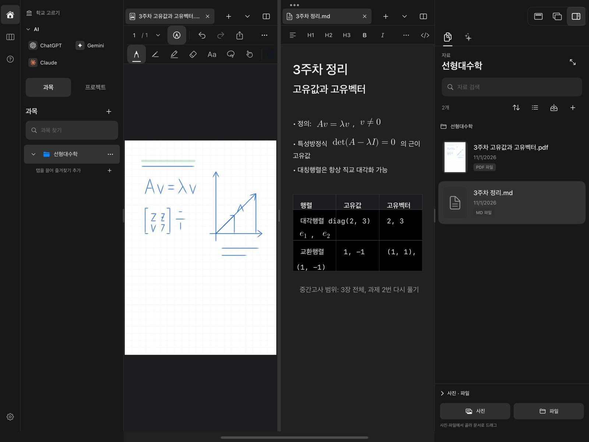

# iPad UI audit (2026-11-01)

The rubric is the `design-taste-frontend` (taste-skill v2) app-screen rules: `references/app-screens.md` §9–§14 and `references/critique.md`.
The skill's browser inspector does not run on SwiftUI, so every judgement here comes from the simulator screenshots, plus pixel measurements taken from them.

**Setup**
- Branch `ui/taste-audit`, on top of the uncommitted library-browser work.
- iPad Pro 13" (M4) simulator in landscape.
- Light and dark appearance, with the appearance setting left on system.
- Screenshots come from `AppStoreScreenshotTests`, `NativeLibraryPresentationUITests`, `NativeBrowserParityUITests`, `NativeSidebarParityUITests`, `NativeSettingsParityUITests` and `NativeDesktopLayoutTests`.
- The light run had 3 failures and the dark run had 2. Both runs report "0 unexpected", meaning the failures are ones the tests already mark as expected.

## Overall verdict

The shell is already close to what the skill recommends for working screens:
- a neutral ground;
- the sidebar on the page ground, not a dark one;
- a near-black primary;
- colour only on data (ink swatches, course colour, status dots);
- one icon set;
- titles at 22–26pt.

It does not read as a template, so a redesign is not warranted.
What costs the most is a short list of **defects** (dark-mode table, unreadable placeholders, a font-size setting that only half works) and some **chrome noise**. The colour direction is fine.

Score (critique.md scale, app-screen caps): **6.5 / 10**. The cap comes from the dark-mode table and the contrast failures. Fixing the top three items below should reach about 8.

## Ranked changes (effect ÷ risk)

### 1. Dark-mode markdown table draws black cells (defect, small fix)

**Cause:** `NativeRichTextLayoutManager.drawBackground` fills cells with `UIColor.systemBackground` and `.secondarySystemBackground`.
- In dark mode that is pure #000 on the editor's `bgApp` #212121, so the table reads as a black hole.
- Ink stays white, but the rules are drawn with `separator` at 0.6 alpha and almost disappear.

**Related problems in the same view:**
- **Header band.** Every header row gets a grey band (§13 bans header bands). The rules alone already separate the rows.
- **Cell text overflow.** Columns are equal widths built from tab stops. In a narrow pane, cell text wraps into the next column's area: "e₁, e₂" lands under 대각행렬 and "(1, −1)" falls out of its row.
- **Monospace everywhere.** All table text is forced into the mono face (`mono: style.contains("table")`), so Korean cell text renders in a code font.

**Fix:**
- Fill cells with `NativeDesktopTheme.bgApp`. Drop the header fill and mark the header row with weight only (it already gets bold).
- Draw rules with `NativeDesktopTheme.border` at full alpha.
- Use the text face for table cells.
- Overflow needs column-aware wrapping and is a larger change. Treat it as a follow-up and, at minimum, clip.

### 2. Placeholders and hint text fail contrast (defect, small fix)

Measured from the light screenshots:

| Text | Measured | Floor |
|---|---|---|
| "자료 검색" placeholder (`NativeLibraryView.swift:87`) | #b3b3b3 on #f2f2f2 = **1.87:1** | 4.5:1 |
| "과목 찾기" placeholder (`NativeCourseSidebar.swift:43`) | #adadad on #eeeeee = **1.93:1** | 4.5:1 |
| Dark "자료 검색" placeholder | #6b6b6b on #282828 = **2.77:1** | 4.5:1 |
| AI footer "첨부한 자료를 바탕으로 답해요" (`NativeAssistantWorkspace.swift:534`, 10pt `.tertiary`) | #c0c0c0 on white = **1.82:1** | 4.5:1, and 11pt minimum |
| "새 대화" subtitle | 4.54:1 | just passes |

The cause is the system placeholder and `.tertiary` colour on the `raised` search fill. **Fix:** pass `prompt: Text(…).foregroundStyle(NativeDesktopTheme.muted)`. `muted` measures 5.3–6.3:1 elsewhere in these shots. Replace `.tertiary`/`.secondary` with the theme tokens, and set nothing under 11pt.

### 3. The font-size setting does not reach most of the UI (defect, mechanical)

Settings › 화면 › 글자 크기 says it scales "앱의 글자와 여백", but scaling only happens through `NativeDesktopTheme.font()`. The code bypasses it heavily:
- **225 bypasses:** `.font(.system(size:` call sites across `App/`.
- **Worst files:** Library 37, Recording 24, PDF palette 16, PDF chrome 16, Assistant 15.
- **No other tokens:** there are no radius or type-role tokens. There are 135 literal `cornerRadius:` values.

**Fix (plan phase 2):**
- Add type roles to `NativeDesktopTheme`, all routed through `font()`.

  | Role | Size |
  |---|---|
  | title | 24 |
  | heading | 16 / semibold |
  | body | 14 |
  | label | 13 |
  | meta | 12 |
  | caption | 11 |

- Add two radii (control 8, container 12) and one floating shadow.
- Migrate file by file, worst first.

### 4. Chrome noise that repeats on every screen (polish, low risk)
- **Course sidebar:** the 과목/프로젝트 segmented control is followed by a "과목 +" heading, so the same word appears twice.
  - Drop the heading and move "+" onto the search row.
  - The AI shortcuts put brand marks in tinted squares (§13 "icons in boxes"). Brand logos are a reasonable exception; keep them, but lose the tinted tile.
- **Planner board** ([04](ipad-ui-audit-2026-11/04-planner-light.jpg)):
  - Each column stacks a border, a header band and a footer band. Keep the border and drop the two bands.
  - Counts "3" and "0" render in a monospace pill, a second face with no job. Use tabular figures in the text face.
  - Two empty columns are 640pt tall with one centred sentence. Top-align the sentence.
- **Settings** ([05](ipad-ui-audit-2026-11/05-settings-light.jpg)):
  - Each card has a header band divided from its body. Fold the title into the body.
  - The 밀도 segmented control stretches to 960pt for two options. Cap it at about 320pt.

### 5. Copy and states (polish, low risk)
- **Mixed register:**
  - "폴더가 비어 있습니다" and the 합니다 sentences in settings, next to
  - "진행 중인 일정이 없어요" and "답해요".

  Pick one register, probably 해요, which most of the app already uses.
- **Empty-state action:** in the empty library, "파일 가져오기" looks like plain grey text. Make it a real text button with the accent ink, since it is the folder's first action (§11 first run).
- **Assistant panel** ([06](ipad-ui-audit-2026-11/06-assistant-light.jpg)): the empty state is a two-line 28pt headline with a sparkle icon, which reads as a landing-page greeting (§14).
  - Replace it with one 16pt sentence.
  - Keep the two suggestion rows, but their ↖ arrows point away from the composer. Use → or no icon.
- **Dates:** `date.formatted(date: .numeric)` follows the device locale, so the simulator (en_US) shows "11/1/2026" inside a Korean UI. This is fine on Korean devices. Fix it only if the UI language is meant to be fixed.

### Kept as is (works, matches the rules)
- The PDF two-row chrome and the window-only tab strip (agreed layout).
- Ink colours as the only saturated hues.
- The neutral light and dark grounds (#fff/#f9f9f9 and #212121/#181818).
- The near-black/white primary.
- The 22–26pt titles.
- The library list with thumbnails.
- The home launcher. Its icon-on-top peer cards are a mild tell, but the cards are real actions; a low priority.

## Screens captured

| Screen | File |
|---|---|
| PDF handwriting | [01](ipad-ui-audit-2026-11/01-pdf-light.jpg) |
| Markdown | [02](ipad-ui-audit-2026-11/02-markdown-light.jpg) |
| Split, dark | [03](ipad-ui-audit-2026-11/03-split-dark.jpg) |
| Planner | [04](ipad-ui-audit-2026-11/04-planner-light.jpg) |
| Settings | [05](ipad-ui-audit-2026-11/05-settings-light.jpg) |
| Assistant | [06](ipad-ui-audit-2026-11/06-assistant-light.jpg) |
| Browser + empty library | [07](ipad-ui-audit-2026-11/07-browser-empty-library-light.jpg) |
| Home + library grid | [08](ipad-ui-audit-2026-11/08-home-library-grid-light.jpg) |

## Applied (2026-11-01, branch `ui/taste-audit`)

| # | Change | Files |
|---|---|---|
| 1 | Table cells no longer get a system fill (black in dark mode) or a header band. Rules use one theme-adaptive 1px line, and cell text uses the text face instead of mono. | `NativeRichTextLayoutManager.swift`, `NativeRichTextEditor.swift` |
| 1b | The assistant panel and composer used `.systemBackground` (also #000 in dark mode); both now use `bgApp`. | `NativeAssistantWorkspace.swift` |
| 2 | 46 `TextField` placeholders now go through `NativeDesktopTheme.prompt()` (the `muted` token, localized). | Every `TextField("…", text: $x)` under `App/` |
| 2b | 56 `.foregroundStyle(.secondary/.tertiary)` calls now use `NativeDesktopTheme.secondary` / `muted`. | `App/Native/*` |
| 3 | 223 `.font(.system(size:…))` calls now go through `NativeDesktopTheme.font()`, so the 글자 크기 setting reaches them. Text below 11pt was raised to 11pt; SF Symbol glyph sizes were kept. | `App/Native/*` |
| 4 | Course and project sidebars: the duplicate heading is gone and "+" sits beside the search field. Planner columns lost the header and footer bands and the mono count pill. Settings cards lost the divided header band, and the 밀도 control is capped at 320pt. | `NativeCourseSidebar`, `NativeLearningHome`, `NativePlannerWorkspace`, `NativeSettingsSections`, `NativeSettingsWorkspace` |
| 5 | Assistant empty state: 18pt title, no hero mark, bordered suggestion rows. Library empty states: "파일 가져오기" is a real tool button, and "폴더가 비어 있어요". | `NativeAssistantWorkspace`, `NativeLibraryView` |

After: [split, dark](ipad-ui-audit-2026-11/after-03-split-dark.jpg) · [planner](ipad-ui-audit-2026-11/after-04-planner-light.jpg) · [settings](ipad-ui-audit-2026-11/after-05-settings-light.jpg) · [assistant](ipad-ui-audit-2026-11/after-06-assistant-light.jpg)

**Not done (follow-ups)**
- **Table cell overflow.** A math attachment wider than its column ("e₁, e₂") still wraps under the first column. This needs column-aware layout.
- **Type roles and radius tokens.** Sizes are still numeric, but now scale. Named roles and the two radii are a separate sweep.
- **Copy register.** 336 strings use the 합니다 form; a 해요 pass is a copy decision for the owner.
- **Suggestion-row ↖ icon.** Left as is.

**Verification**
- **Unit tests:** `BandalTests` ran 1166 tests with 0 failures.
- **Full `BandalUITests`:** 19 failures.
  - 17 of them also fail on committed `HEAD` without these changes (re-run in a clean worktree).
  - `testDetailedLibraryExpands…` belongs to the uncommitted library work and already failed before these changes.
  - `testLocalBrowserSuggestions…` was re-run separately (see below).
  - After the assistant-background fix, `NativeBrowserParityUITests` and `NativeSidebarParityUITests` were run twice and passed all 5 tests both times. The earlier `testLocalBrowserSuggestions…` failure ("no longer valid after interruption handling") did not reproduce.
