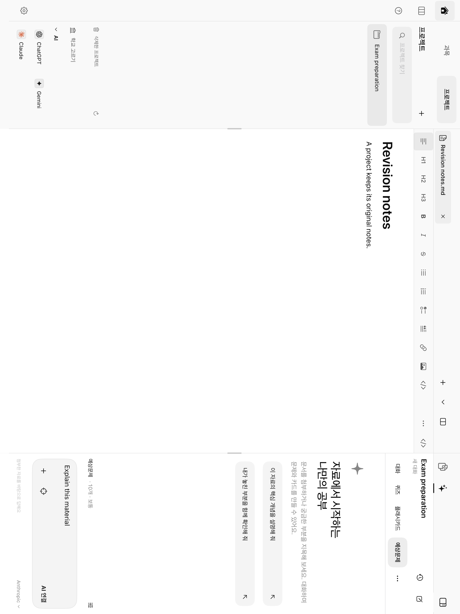
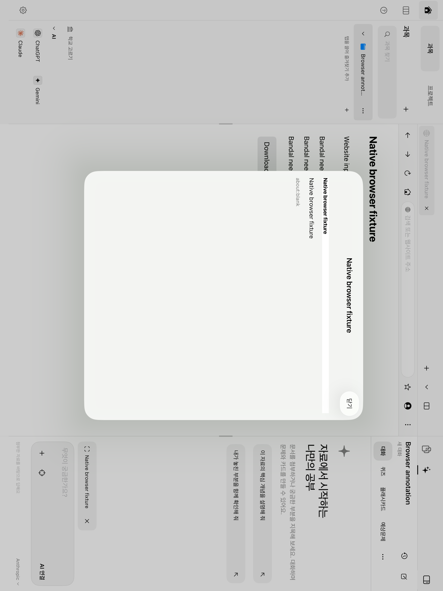
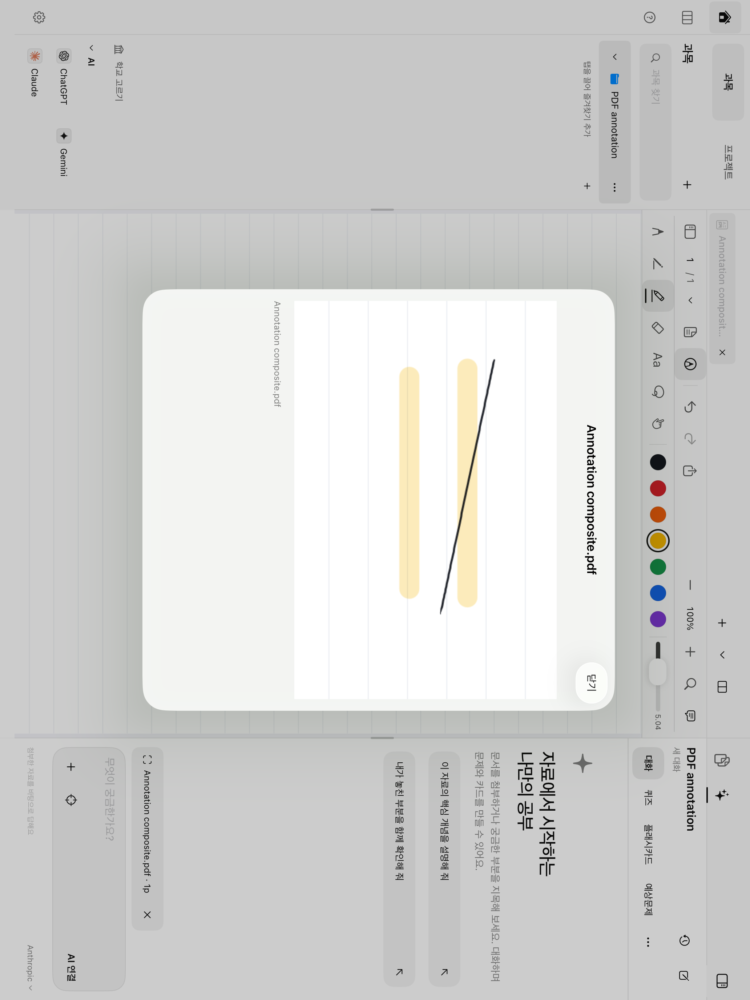
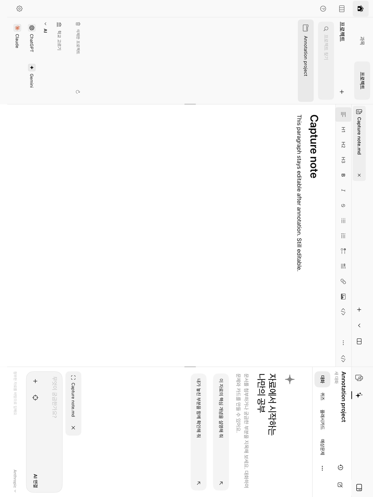
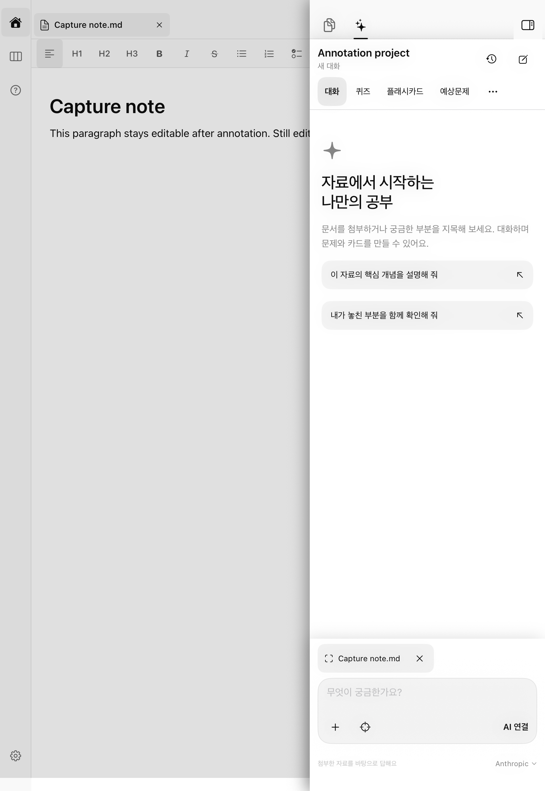

# iPad 홈·자료·AI 통합 개편

2026-10-23 구현 기록. 기존 작업 폴더의 PDF·브라우저·자료·공유 개선 변경 위에 추가했으며 기존 자료의 저장 형식과 소유 과목은 유지한다.

## 화면과 탐색

- 홈의 과목·프로젝트 선택기는 같은 제목·검색·추가·폴더 목록 구조를 사용한다. 프로젝트는 이름만 입력해 독립 공간으로 생성한다. 이전 영어 읽기·과목 복습 공간과 표현·학습 기록도 프로젝트에서 접근한다.
- 오른쪽은 자료·AI 두 탭이다. 창 오른쪽 위의 버튼 하나가 패널을 접고 펼친다. 자료의 보기 방식·가져오기·생성하기·새로고침, 기존 네 가지 보기와 사진·파일 보관함을 유지한다.
- 문서와 퀴즈·카드·예상문제·요약·읽기 자료는 중앙의 독립 탭으로 열린다. 같은 결과를 다시 고르면 기존 탭으로 이동한다.
- 창 너비 1,200pt 이상은 양쪽 고정, 900–1,199pt는 오른쪽 고정, 900pt 미만은 오른쪽도 겹침 패널이다. 600pt 미만의 오른쪽 패널은 전체 너비를 쓴다. 기본 오른쪽 너비는 360pt이며, 문서에 최소 480pt를 남기도록 고정 패널 폭을 제한한다.

`NativeWorkspaceContext`가 화면의 공간을, 문서의 `courseID`가 실제 저장 소유자를 나타낸다. 연결된 과목 원문을 열어도 프로젝트 화면과 대화는 유지된다. 프로젝트 ID로 분할 배치와 대화를 식별하고, 비활성 프로젝트의 이전 저장 위치도 기록한다. 폴더 이동 후에는 저장된 PDF·노트·학습 결과를 새 경로로 다시 연결하며 연결된 외부 과목 원문은 유지한다. 이전 화면 저장 형식은 활성 프로젝트와 학습 결과에 남은 저장 위치로 재연결한다.

## AI와 생성 결과

설정의 OpenAI·Anthropic·Google API 키와 Keychain을 재사용한다. 대화·퀴즈·플래시카드·예상문제는 모드 탭, 요약·영어 읽기는 더보기에서 고른다. 모드는 다음 요청에 적용되고 현재 대화·초안·실행 중 요청은 유지된다. 키가 없어도 기록·초안·첨부를 사용할 수 있다.

요청 시작 시 공간·모드·문서·첨부를 고정한다. 생성 중 다른 공간으로 이동해도 결과는 원래 공간에 보관한다. 과목에서 생성하면 기존 연결 복습 공간을 재사용한다. 예상문제는 제출 전 해설·정답을 숨기고 제출 후 채점·출처·서술형 자기평가를 제공한다. 수정 생성은 새 결과로 저장해 기존 풀이를 유지한다.

기존 문서별 AI 진입은 공통 패널로 연결한다. 과거 대화는 원래 과목 범위에서 복원하며, 소유 공간을 확정할 수 없는 이전 미전송 초안은 기록 메뉴의 명시적인 복구 항목으로 남긴다.

## 지목해서 질문

PDF·노트의 텍스트와 사각 영역, 웹의 텍스트·DOM 요소·사각 영역을 지원한다. 키보드와 겹침 패널을 접은 뒤 편집기 내부만 선택한다. 캡처는 자동 전송하지 않고 입력창에 첨부한다.

PDF 캡처는 원본·필기·형광펜·도형·삽입 이미지를 합성한다. 회전된 페이지와 crop box의 좌표를 변환하고 최대 변 길이 2,048px·약 400만 화소로 제한한다. 선택 중 회전이나 문서 변경이 감지되면 오래된 요청을 적용하지 않는다. 다른 분할 창에 대한 편집 입력을 막고 취소·완료 후 원래 도구를 복원한다.

첨부에는 당시의 이미지·텍스트·문서·페이지·URL을 저장한다. 대화 재개와 동기화에도 해당 스냅샷을 유지한다. 큰 이미지는 바이너리 동기화 자산으로 분리한다. 초안은 대화마다 따로 저장하며 공간 전환 중 전달 대기 캡처도 공간별로 보관한다.

## 화면

테스트용 프로젝트와 문서로 캡처한 화면이다.

## 검증 범위

Xcode 26.2와 iPadOS 26.3 시뮬레이터의 격리된 테스트 저장소에서 검사했다. 테스트용 합성 필기와 인라인 웹 문서를 사용했으며 실제 API 비용이나 사용자 문서 변경은 발생시키지 않았다.

검사 대상은 공간·배치 복원, 기존 학습 데이터와 독립 답안, 대화 접근 범위, 생성 취소와 원래 저장 위치, 첨부 저장·전송 계약·동기화, 회전된 PDF 합성 캡처, 편집기 회귀, 실제 홈·AI·지목 화면 흐름이다.

- 관련 고유 단위·통합 검사 **146개 통과**. 개인 PDF 경로를 환경 변수로 받는 별도 재생 검사 1개는 해당 문서를 제공하지 않아 건너뛰었다.
- 고유 UI 흐름 **5개 통과**: 프로젝트 생성·문서·AI 초안 재실행 복원, 노트 지목·취소·회전, PDF 합성 첨부·필기 복귀, 웹 요소·영역 지목, 웹 텍스트 지목.
- iPad Pro 13형과 11형에서 홈·패널 흐름을 검사했다. 11형 세로 화면에서는 오른쪽 겹침 패널의 위치와 버튼 하나 유지를 확인하고 지목 버튼에 실제 터치를 보내 선택 모드 진입·취소·가로 복귀를 검증했다. 회전 후 XCTest의 `isHittable` 판정이 실제 터치와 달라, 최종 회귀 검사는 버튼 위치·활성 상태와 터치 후 화면 동작을 확인한다.
- PDF 지목 도구 전환 시 렌더러의 상태 세대를 갱신하도록 수정했다. 실제 PDF 호스트에서 펜·형광펜 필기 후 지목 진입·전환·취소를 거쳐 세 번째 필기가 저장되는 회귀 검사와 화면 검사를 모두 통과했다.
- 최종 집계에 사용한 결과 번들: `.build/ui-redesign-verified.xcresult`, `.build/ui-redesign-pdf-final.xcresult`, `.build/ui-redesign-compact-final.xcresult`, `.build/ui-redesign-drawer-final.xcresult`, `.build/ui-redesign-composer-final.xcresult`, `.build/ui-redesign-portrait-touch.xcresult`. 수정 전 실패는 원인을 고친 뒤 해당 검사를 다시 실행했으며, 위 수는 테스트 이름별 최종 결과를 집계한 값이다. 이름별 결과는 `.build/ui-redesign-final-test-summary.json`에 남겼다.

실제 제공자 API 키를 사용한 전송·이미지 해석·생성, 물리 Apple Pencil의 필압·팜 리젝션·지연은 별도 실기기 검증이 필요하다. Split View·Stage Manager의 너비 정책은 단위 검사로 검증하며 모든 실제 창 배치 조합을 자동화한 것은 아니다.

## 실제 iPad 설치 — 2026-10-23

사용자의 설치 요청에 따라 **Release 1.0.0 (7)**을 iPad Pro 11형 3세대에 기존 앱 업데이트로 설치했다. 설치 시 기기가 보고한 OS는 iPadOS 27.0.1이다. 앱과 공유 확장의 버전·서명·기기 프로비저닝·App Group을 검사했으며, 테스트 인자 없이 앱을 실행하고 마지막 프로세스 생존을 확인했다. [설치 결과](ipad-workspace-redesign-2026-10-23/device-installation.json), [서명 결과](ipad-workspace-redesign-2026-10-23/device-signing.json).

설치 전후 Documents·Preferences·ShareInbox를 각각 로컬로 백업했다. 설치 전 백업은 약 2.0GB이며, 원본 백업은 `.build/device-backups/workspace-redesign-2026-10-23/`에 보관했다. SQLite는 WAL·SHM을 포함한 임시 사본에서만 열어 검사했다.

| 비교 대상 | 결과 |
|---|---|
| 자료 파일 | 104개 모두 같은 경로·같은 해시, 누락 없음 |
| 필기·화이트보드·저장 영수증 | 기존 40,234행의 모든 기존 열·값 유지 |
| 그 밖의 내용 테이블 | 기존 38행 유지 |
| SQLite | 6개 무결성 정상 |
| 전체 Documents 파일 | 기존 159개 누락 없음, 153개 동일, 운영 파일 6개 변경, 2개 추가 |
| Preferences | 기존 51개 키 모두 유지, 47개 값 동일, 4개 값 변경, 1개 키 추가 |
| ShareInbox | 기존 2개 파일 모두 같은 해시 |

변경된 DB 메타데이터는 설치 컨테이너의 폴더 경로 재연결, 갱신 시각, 검색 파일 상태 표식이다. 변경된 7개 테이블 모두 기존 행 식별자가 유지됐다. 설정 차이는 StoreKit 운영 시각, 한 문서의 PDF 읽기 위치, 이전 경로 이력 추가와 자료 패널 표시 상태다. 이전 경로 이력 13개는 모두 남고 1개가 추가됐으며, 새 설정 키는 오른쪽 패널의 탭 선택이다.

자료·필기 보존과 실행 중 바뀌는 운영 메타데이터를 구분해 [설치 전후 비교 결과](ipad-workspace-redesign-2026-10-23/device-data-preservation.json)에 기록했다. 실기기는 설치·일반 실행·자료 보존을 검사했으며, 위 UI 자동화와 물리 Pencil 사용감 검증을 대신하지 않는다.
